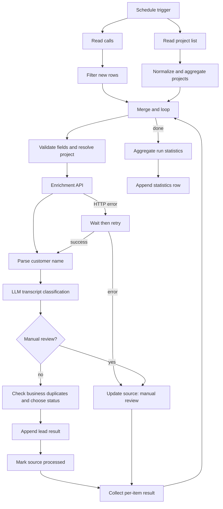

# AI-powered Call Classification & Lead Processing (n8n)

An **anonymized portfolio case study** of a Google Sheets → n8n → LLM workflow. The system orchestrates structured lead processing while reserving AI for unstructured transcript interpretation.

> **Status:** Portfolio workflow export, **not a verified plug-and-play deployment**. The export intentionally contains placeholder spreadsheet IDs and enrichment API settings. See [Technical review](docs/technical-review.md) for limitations before using it with live data.

## What it does

- Reads call records from Google Sheets and filters records with empty `automation_status`.
- Fetches a project-name reference list and resolves call projects, including ambiguous inbound calls.
- Processes calls one at a time in a loop and marks source rows as `processing`.
- Enriches a phone number with possible customer names from an external API, applying deterministic parsing logic.
- Uses an OpenAI text model to classify a call transcript into `стоп-лист`, `не лид` or `лид УМТМ`; ambiguous cases go to `manual_review` with a machine-readable `reason_code` and Russian `reason_text`.
- Checks potential business duplicates by project + phone and a previous business-day rule.
- Appends classified results, updates source processing states, and writes per-run statistics.
- Routes enrichment HTTP errors through a delayed retry and then to the manual-review path if the second attempt fails.

**Two distinct notions of duplication:** business status `дубль` means a repeat customer interaction; *idempotency* means preventing the same source call from being appended more than once. The latter is **not guaranteed** in this current export.

## Architecture

## Stack

**n8n**, **Google Sheets**, **OpenAI API**, **JavaScript in Code nodes**, and a configurable external customer-enrichment HTTP API.

## Import and configuration

1. Import [`workflows/call_processing.sanitized.json`](workflows/call_processing.sanitized.json) into your own n8n instance.
2. Add your own Google Sheets and OpenAI credentials. Never put keys in public JSON.
3. Open **every Google Sheets node** and reselect the document and sheet. `REPLACE_WITH_*` values are deliberate placeholders.
4. Set the enrichment HTTP endpoint in **both** HTTP Request nodes and configure the `x-api-key` header through secure n8n credentials. The sample `api.example.com` endpoint is intentionally non-functional.
5. Verify the project-list sheet, the destination columns, prompt/model access, timezone and scheduling settings.
6. Use **synthetic data** in dedicated test spreadsheets before activating. Check the [review checklist](docs/technical-review.md).

### Expected spreadsheet columns

| Source sheet (`Calls`) | Target sheet (`Leads`) | Stats sheet (`Statistics`) |
| --- | --- | --- |
| `Дата`, `Номер`, `Скрипт`, `Цель`, `Транскрибация`, `automation_status`, `automation_comment` | `Дата`, `Телефон`, `Имя`, `Проект`, `Текст ответа`, `Статус` | `Дата запуска`, `Execution ID`, `Всего`, `Обработано`, `Лид УМТМ`, `Не лид`, `Стоп-лист`, `Дубль`, `Ручная проверка`, `Ошибки` |

The project-reference sheet needs a `проект` column. Spreadsheet headers and status labels are intentionally preserved from the original workflow to keep expressions understandable.

## Sample data

Only fictitious examples are included: [calls](examples/synthetic_calls.json) and [outcomes](examples/synthetic_outcomes.json). No actual audio, phone numbers, personal names or transcripts from the original business appear in these files.

## Engineering decisions

- **Hybrid LLM + rules:** an LLM interprets speech, while status priority, date checks, row routing and statistics are implemented deterministically.
- **Human-in-the-loop:** uncertain results are recorded in the existing source spreadsheet with actionable reason codes.
- **Batch processing:** the loop processes one source record at a time, with a `done` path for per-execution metrics.
- **API fault handling:** one delayed repeat request on enrichment errors, then an exception path.

## Limitations and next steps

This is an anonymized snapshot of a working prototype, not a claim of production readiness. The export has **known edge cases** around exactly-once writes, concurrent runs, stale `processing` rows, some status labels in statistics, item references and error handling for OpenAI/Google Sheets. See [docs/technical-review.md](docs/technical-review.md) before production use.

## Privacy and publication

The export removes credential bindings, live spreadsheet IDs, URLs, instance/workflow IDs, node UUIDs, and cached column metadata not needed by mapped fields. It does **not** grant rights to disclose a client's proprietary workflow logic. Publish only after confirming you are permitted to share an anonymized process description. See [SECURITY.md](SECURITY.md).

## License

No license is granted by default; obtain authorization for the applicable project intellectual property before choosing an open-source license.
